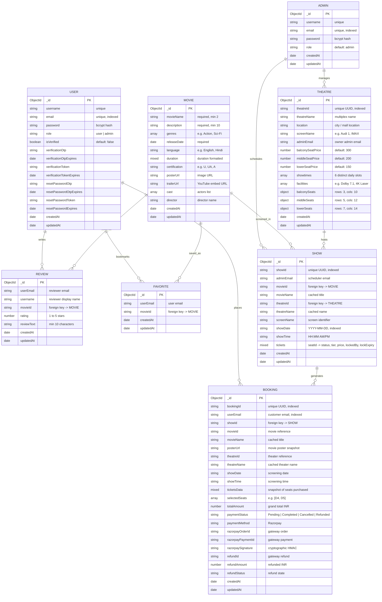

# 📊 Entity-Relationship (ER) Diagram

The following diagram represents the core data entities, schemas, and relational associations in the **iMovies** MongoDB database modeled via **Mongoose**.

---

## 📐 Mermaid.js ER Diagram

---

## 🔍 Schema Relationships & Indexing Strategy

### 1. Relationships & Foreign Keys
* **`User -> Booking`**: One-to-many relationship mapped via `userEmail`. Allows fast queries for personal booking history without requiring cross-collection joins.
* **`Show -> Theatre`**: Linked through `theatreId`. The `theatreName`, `screenName`, and pricing tiers are cached in the `Show` document to prevent runtime lookup latency.
* **`Show -> Movie`**: Linked through `movieId`. Movie titles and poster URLs are snapshot into `Booking` records to preserve historical integrity even if movie records are edited later.
* **`Booking -> Show`**: Linked through `showId`. Seat availability in `show.tickets` is updated atomically using Mongoose `$set` operators when seats are locked, booked, or released.

### 2. Compound Indexes for High-Traffic Queries
* **`Show` Collection**:
  - `{ movieId: 1, showDate: 1, theatreId: 1 }`: Optimized for movie-specific schedule lookups with optional date and theater filtering.
  - `{ theatreId: 1, showDate: 1, showTime: 1 }`: Guarantees non-overlapping schedule uniqueness per theater screen.
* **`Review` Collection**:
  - `{ userEmail: 1, movieId: 1 }` (Unique): Enforces one review per user per movie.
* **`Favorite` Collection**:
  - `{ userEmail: 1, movieId: 1 }` (Unique): Eliminates duplicate bookmark entries.
* **`Booking` Collection**:
  - `{ bookingId: 1 }` (Unique): Enables instant lookup for public ticket verification (`/tickets/view/:bookingId`).
  - `{ userEmail: 1, createdAt: -1 }`: Accelerated sorting for user dashboard booking history.
