# 🗺️ User Flow & System Journey Diagram

This document illustrates the end-to-end customer journey from landing page discovery through showtime selection, interactive seat booking, secure Razorpay checkout, dynamic ticket generation, and post-booking ticket cancellation.

---

## 📈 Mermaid.js Flowchart Diagram

```mermaid
flowchart TD
    %% Entry & Discovery
    Start([User Visits iMovies]) --> Landing[Landing Page / Movie Discovery]
    Landing --> SearchFilter{Search or Filter?}
    SearchFilter -->|Filter by Genre/Country| FilteredMovies[Explore Movies by Genre or Region]
    SearchFilter -->|TMDB Live Feed| TrendingMovies[View Now Showing & Trending Blockbusters]
    SearchFilter -->|Search Title| MovieSearch[Search Movies Catalog]

    FilteredMovies --> SelectMovie[Select Movie]
    TrendingMovies --> SelectMovie
    MovieSearch --> SelectMovie

    %% Movie Exploration
    SelectMovie --> MovieDetails[Movie Details Page]
    MovieDetails --> WatchTrailer[Watch Official HD Trailer Modal]
    MovieDetails --> ViewReviews[Read Viewer Reviews & Cast Info]
    MovieDetails --> ToggleFav{Add to Favorites?}
    ToggleFav -->|Yes| CheckAuthFav{User Logged In?}
    CheckAuthFav -->|No| LoginModal[Redirect to Login]
    CheckAuthFav -->|Yes| SaveFav[Bookmark Movie to Favorites]

    %% Authentication
    MovieDetails --> ClickBook[Click 'Book Tickets']
    ClickBook --> CheckAuth{Authenticated?}
    CheckAuth -->|No| AuthChoice{Account Exists?}
    AuthChoice -->|No| Register[Register with Email & Username]
    Register --> EmailVerify[Brevo Transactional Email Verification: OTP or Magic Link]
    EmailVerify --> Login[Login with Credentials]
    AuthChoice -->|Yes| Login
    Login --> JWTStored[Store JWT Token in LocalStorage]
    JWTStored --> MovieShows[Movie Shows & Theater Selection Page]
    CheckAuth -->|Yes| MovieShows

    %% Theater & Showtime Selection
    MovieShows --> SelectDate[Select Date: Next 7 Days Carousel]
    SelectDate --> FilterTheatre{Filter by Theater?}
    FilterTheatre -->|All Theaters| ShowAllTheatres[Display All 4 Multiplex Schedules]
    FilterTheatre -->|Specific Theater| FilterByLocation[Display Only Selected Theater Location]
    ShowAllTheatres --> ShowChips[View 6 Daily Showtime Chips per Theater]
    FilterByLocation --> ShowChips

    ShowChips --> CheckTimeExpired{Is Showtime Expired?}
    CheckTimeExpired -->|Yes: Current Time >= Show Time| DisabledChip[Show Disabled & Marked as 'Passed']
    DisabledChip --> SelectAnotherTime[Choose Upcoming Showtime]
    SelectAnotherTime --> ShowChips
    CheckTimeExpired -->|No: Upcoming Show| SelectShow[Click Show Time Chip]

    %% Seat Selection & Holding
    SelectShow --> SeatLayout[Seat Selection Screen]
    SeatLayout --> ScreenGuide[Visual Cinema Screen Indicator facing Lower Tier]
    SeatLayout --> PickSeats[Select Desired Seats in Balcony, Middle, or Lower Tier]
    PickSeats --> LockSeatsBtn[Click 'Lock Seats']
    LockSeatsBtn --> PostLock[POST /api/bookings/lock via Backend]
    PostLock --> SocketLock[Socket.io Broadcasts 'seats:locked' to all clients]
    SocketLock --> StartTimer[10-Minute Hold Countdown Timer Starts]

    %% Checkout & Payment
    StartTimer --> ClickPay[Click 'Proceed to Pay']
    ClickPay --> CreateOrder[POST /api/payment/create-order -> Razorpay Order Created]
    CreateOrder --> LaunchRazorpay[Launch Razorpay Checkout Modal]
    LaunchRazorpay --> PaymentMethod{Choose Payment Instrument}
    PaymentMethod -->|UPI| PayUPI[Google Pay, PhonePe, Paytm, QR Code]
    PaymentMethod -->|Card| PayCard[Credit / Debit Card]
    PaymentMethod -->|NetBanking| PayNet[NetBanking & Wallets]

    PayUPI --> ProcessPayment[Process Transaction]
    PayCard --> ProcessPayment
    PayNet --> ProcessPayment

    ProcessPayment --> PaymentSuccess{Payment Successful?}
    PaymentSuccess -->|Failed / Dismissed| PaymentFailed[Payment Failed / Order Pending]
    PaymentFailed --> RetryPay[Retry Payment within 10-Minute Hold Window]
    RetryPay --> LaunchRazorpay

    PaymentSuccess -->|Success| VerifySig[POST /api/payment/verify -> HMAC-SHA256 Signature Validated]
    VerifySig --> FinalizeBooking[Booking Status Marked as 'Completed']
    FinalizeBooking --> ReleaseLock[Seats Permanently Booked in MongoDB]
    FinalizeBooking --> SendBrevoTicket[Brevo Dispatches HTML Confirmation Ticket to Email]
    FinalizeBooking --> SocketBooked[Socket.io Broadcasts 'seats:booked']

    %% Ticket Experience & Sharing
    FinalizeBooking --> TicketSuccess[Booking Confirmation Screen]
    TicketSuccess --> ViewTicketModal[View Digital Cinema E-Ticket]
    ViewTicketModal --> DynamicQR[Dynamic Scannable QR Code Generated]
    ViewTicketModal --> ShareTicketOptions{Share Ticket}
    ShareTicketOptions -->|WhatsApp| WhatsAppShare[1-Click Share to WhatsApp]
    ShareTicketOptions -->|Web Share / Copy| SharePublicLink[Copy Unique URL: /tickets/view/:bookingId]
    ShareTicketOptions -->|Print| PrintTicket[Print PDF / Physical Ticket]

    SharePublicLink --> PublicViewer[Friend Opens Link: Unauthenticated Public Ticket View]

    %% Post-Booking & Cancellation Engine
    TicketSuccess --> MyBookings[Navigate to 'My Bookings']
    MyBookings --> BookingList[View History of Reserved Tickets]
    BookingList --> CancelRequest{User Requests Cancellation?}
    CancelRequest -->|No| EnjoyMovie[Attend Screening at Cinema]
    CancelRequest -->|Yes| CheckPolicy{Time to Show >= 2 Hours?}
    CheckPolicy -->|No: < 2 Hours to Show| DisableCancel[Cancellation Closed: Non-Refundable]
    CheckPolicy -->|Yes: >= 2 Hours| OpenCancelModal[Display Cancellation Policy Confirmation Modal]
    OpenCancelModal --> ConfirmCancel[Click 'Confirm Cancellation']
    ConfirmCancel --> PutCancel[PUT /api/bookings/cancel/:bookingId]
    PutCancel --> UpdateBookingStatus[Booking Payment Status Set to 'Cancelled']
    UpdateBookingStatus --> ResetSeats[Reserved Seats Reset to 'available' in MongoDB]
    ResetSeats --> SendCancelEmail[Brevo Dispatches Cancellation Notice Email]
    SendCancelEmail --> SocketReleased[Socket.io Broadcasts 'seats:released']
    SocketReleased --> RefundCompleted([Cancellation Complete: Seats Released])
```

---

## 🧭 Step-by-Step Flow Explanation

### Phase 1: Discovery & Catalog Browsing
1. User lands on the home view and discovers movies grouped by genres (Action, Drama, Comedy, Sci-Fi) and countries (India, Hollywood, Korea, UK).
2. Live blockbusters, trailers, synopsis, and metadata are synchronized via the TMDB API.
3. Users can watch full HD official trailers directly within an embedded modal player.

### Phase 2: Authentication & Security
1. Users authenticate via standard credentials or email OTP verification using the Brevo transactional email engine.
2. Upon login, a signed JSON Web Token (JWT) is stored in client memory/localStorage.
3. Protected user endpoints validate credentials via the `fetchUser` middleware.

### Phase 3: Theater & Showtime Selection
1. Viewers select their preferred screening date across a dynamic 7-day date slider.
2. A location filter bar allows viewers to view **"All Theaters"** or isolate a specific multiplex (PVR IMAX Kurla, INOX Megaplex Ghatkopar, Cinepolis VIP Seawoods, Miraj Andheri).
3. Each theater features **6 distinct daily showtimes** (morning, afternoon, matinee, evening, prime, late night).
4. Any show whose scheduled start time has passed relative to the real-time clock is automatically disabled and tagged with a `"Passed"` badge.

### Phase 4: Interactive Seating & Real-Time Locking
1. The seat layout dynamically arranges **Balcony** (₹300-₹400), **Middle** (₹200-₹280), and **Lower** (₹140-₹180) tiers.
2. The visual **Cinema Screen Indicator** is positioned directly adjacent to the budget-friendly Lower Tier seats.
3. Locking seats claims a temporary 10-minute hold reservation via `POST /api/bookings/lock`. Socket.io broadcasts `seats:locked` across all connected clients to prevent double-booking.

### Phase 5: Razorpay Checkout & Cryptographic Verification
1. Clicking "Proceed to Pay" calls `/api/payment/create-order` to generate a Razorpay Order ID.
2. The user selects UPI (Google Pay, PhonePe, Paytm, QR), Credit/Debit Card, or NetBanking inside the official checkout modal.
3. Server-side payment verification validates the HMAC-SHA256 signature against `RAZORPAY_KEY_SECRET`.
4. Upon successful payment, the booking status transitions to `'Completed'`, seats are permanently assigned to the user, and a Brevo HTML ticket receipt is delivered to the customer's inbox.

### Phase 6: Public E-Ticket Sharing & QR Validation
1. An official E-Ticket displays the movie poster, theater screen, dates, times, and a dynamic QR code synthesized via `qrcode`.
2. Users can share the ticket via WhatsApp, download/print it, or copy a public link (`/tickets/view/:bookingId`).
3. The public ticket route is unauthenticated, allowing entrance gate attendants or friends to view the verified ticket without logging in.

### Phase 7: Strict 2-Hour Cancellation Engine
1. Users can review tickets in their **My Bookings** dashboard.
2. A strict 2-hour cutoff rule is enforced:
   $$\text{Cancellation Allowed} = (\text{Show Start Time} - \text{Current Time}) \ge 2\text{ hours}$$
3. If less than 2 hours remain before showtime, cancellation is disabled with a notice.
4. If eligible, the user confirms cancellation via a modal. The backend resets the seats back to `'available'` in MongoDB, notifies Brevo, and broadcasts `seats:released` via Socket.io.
